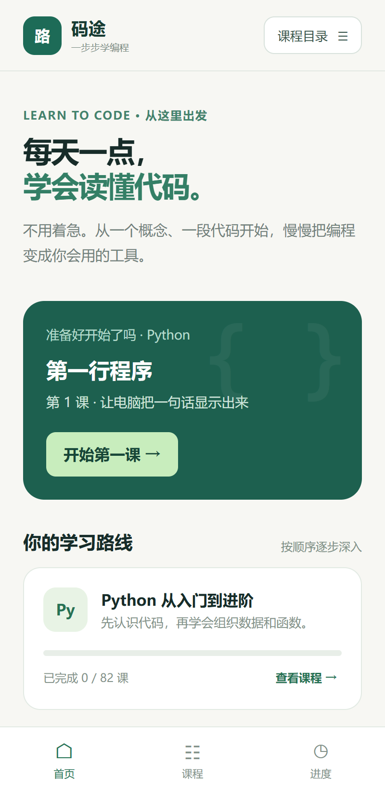
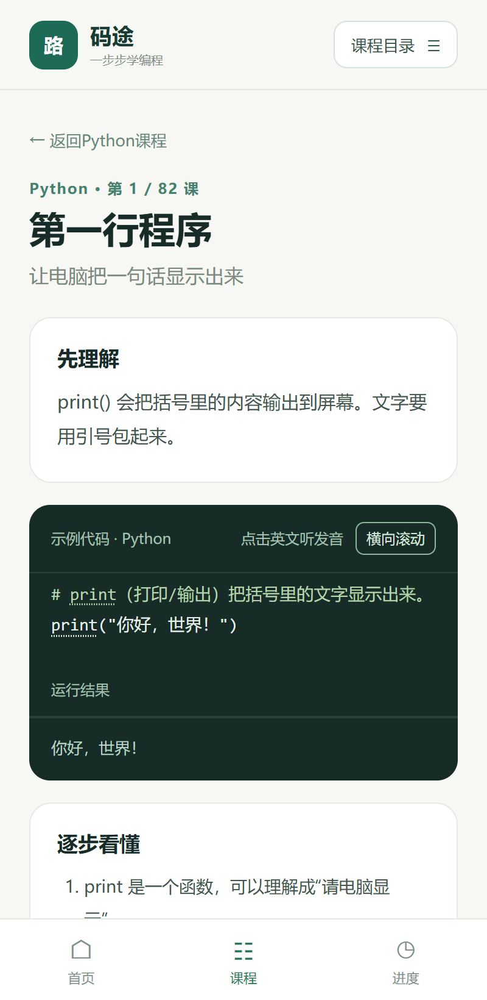

# 码途

**每天一点，学会读懂代码。**

码途是一款面向编程初学者的中文编程阅读学习 App。它把概念说明、带中文注释的代码、示例结果和小练习放在同一节课中，让学习从“先看懂一段代码”开始。

项目使用 JavaScript、HTML、CSS 实现课程界面，通过 Capacitor 接入 Android 工程。课程内容随应用提供，学习进度保存在当前设备，既能在浏览器预览，也能作为 Android 应用打包。

## 界面预览

<p>
  
  
</p>

本地浏览器截图，展示首页与课程阅读页。

## 一次学习是怎样进行的

1. **选一条路线**：从 Python、网页、数据库或移动开发等方向进入，按章节逐步阅读。
2. **先理解概念**：用中文说明这一课解决什么问题、代码中的词是什么意思。
3. **对照代码与结果**：把注释、示例请求或输出放在代码附近，减少来回查找。
4. **按需要练习**：选择题给出反馈；看懂后也可以直接继续下一课。
5. **下次接着学**：保存已完成课程与最近阅读位置，首页提供继续学习入口。

## 功能与体验

### 按路线和章节组织内容

当前课程分为三个方向，共 14 条路线：

- **Python 与后端**：Python、SQL、FastAPI。
- **网页与小程序**：HTML/CSS、JavaScript、TypeScript、Node.js、React、Vue、微信小程序。
- **Java、Kotlin 与安卓**：Java、Spring Boot、Kotlin、Android。

每条路线包含自己的章节、课时顺序与进度。课程介绍也会说明技术之间的关系，例如 JavaScript 与 React/Vue、Python 与 FastAPI、Java 与 Spring Boot，帮助初学者判断从哪里开始。

已有课时属于持续扩充中的学习内容，不代表覆盖对应语言或框架的全部能力。

### 用中文理解代码

课程将概念、代码、词汇与逐步讲解放在同一页面。部分课程使用多个代码块说明不同文件或步骤，接口课程额外展示示例请求与响应。

代码区支持切换换行与横向滚动；英文标识可以点击朗读。朗读调用设备或浏览器提供的语音能力，可用性取决于当前环境及语音设置。

### 搜索正在遇到的问题

课程目录提供搜索入口，检索范围包含课程标题、概念说明、词汇、代码及讲解等内容。搜索结果显示所属路线，可以直接打开对应课程，适合按关键词查阅。

### 在自己的节奏中继续

练习为可选内容，完成课程后记录进度。首页根据最近阅读和完成情况选择继续入口，进度页展示各路线的完成比例与已完成课程。

学习记录保存在当前环境的 `localStorage`，无需先登录。当前版本不提供云端同步，清理浏览器数据或更换设备会影响本地记录。

## 设计与技术实现

- **以阅读为中心的界面**：首页、课程和进度三个主要入口，课程内按照概念、代码、结果和练习展开。
- **课程数据与页面逻辑分离**：不同技术路线使用独立模块，统一由课程目录与查找函数组织。
- **共享的课程模型**：路线、章节、课程查找、进度统计和下一课推荐复用同一套数据，避免各页面分别维护目录。
- **本地学习状态**：已完成列表和最近阅读位置持久化，恢复时对保存的数据作基本检查。
- **统一的内容搜索**：启动时基于课程信息构建搜索索引，支持跨路线查找。
- **Web 与 Android 复用**：打包脚本按明确清单复制当前课程所需资源，再由 Capacitor 同步到 Android 工程。

界面本身采用原生 JavaScript。React、Vue 等既是课程主题，也用于部分开发检查，不应将课程涉及的所有技术都理解为应用运行时框架。

## 快速运行

需要 Node.js、npm，以及用于静态预览的 Python。

```sh
npm ci
npm run serve
```

浏览器打开 http://localhost:4173 。静态文件加载后，课程阅读不依赖在线教学接口；语音能力由当前设备决定。

## 自动化检查

```sh
npm test
```

当前仓库保留 4 个课程测试文件，检查范围包括：

- 课程资源清单是否覆盖本地模块依赖。
- 路线与章节入口是否对应实际课程。
- 不同路线的进度统计与课程顺序。
- 课程说明、注释、代码和练习等内容结构。
- 页面中的阅读、代码换行与朗读相关交互。

此前导入时在原工作区执行上述测试，24 项通过。该结果对应课程检查，不代表 Android 真机验收或所有教学示例的独立运行验证。

## Android 构建

先准备兼容的 JDK 与 Android SDK，再同步课程资源：

```sh
npm run sync
cd android
./gradlew assembleDebug
```

Windows 使用 `gradlew.bat assembleDebug`。调试包输出到 `android/app/build/outputs/apk/debug/`。

本地 SDK 路径通过环境变量或 `android/local.properties` 配置。正式签名需自行提供签名材料与相关环境变量；仓库不包含本地凭据或签名密钥。

## 源码导航

```text
www/
  index.html                应用外壳与导航入口
  course.css                页面布局与样式
  course-app.mjs            页面渲染、交互、搜索与本地学习记录
  course-tracks.mjs         路线、章节、课程查找与进度逻辑
  course.mjs                基础课程与答题判断
  course-guidance.mjs        课程讲解
  course-annotations.mjs     代码注释组织
  *-lessons.mjs              各语言与框架的课程内容
scripts/build-matu.mjs      课程资源清单与复制脚本
tests/                     课程与页面检查
android/                   Capacitor Android 工程
```

理解项目可以从 `www/index.html` 进入 `www/course-app.mjs`，沿着“打开路线—打开课程—完成课程—保存进度”的流程阅读，再到 `www/course-tracks.mjs` 查看课程组织方式。

## 项目范围

这个仓库整理的是当前课程版源码，不包含本地项目中保留的历史词库、旧音频、旧运行器和构建产物。

课程中的接口响应、平台页面和数据效果属于教学示例。阅读页面不会自动启动示例后端、发出示例网络请求，或保存示例业务数据。正式签名、跨设备体验与新版真机验收仍需进一步完成。

课程结构参考 [Python 官方教程](https://docs.python.org/3/tutorial/) 及各语言、框架的官方资料，中文讲解与示例随项目持续完善。参考资料、依赖许可和具体内容的使用范围应分别确认。
